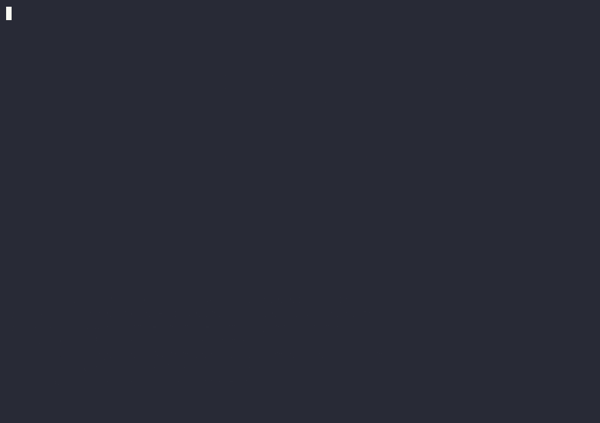

<h1 align="center">Doppelganger</h1>

<p align="center">
  <strong>Fine-tune an LLM on your own chat history to mimic how you write</strong>
</p>

<p align="center">
  <a href="#features">Features</a> •
  <a href="#quick-start">Quick Start</a> •
  <a href="#usage">Usage</a> •
  <a href="#fine-tune-your-model-lora">Fine-Tuning</a> •
  <a href="#privacy--sensitive-data">Privacy</a>
</p>

<p align="center">
  
  
  
  
  
</p>

<p align="center">
  
  <a href="docs/sources/telegram.md"></a>
  <a href="docs/sources/whatsapp.md"></a>
  <a href="docs/sources/instagram.md"></a>
  <a href="docs/sources/messenger.md"></a>
  <a href="docs/sources/line.md"></a>
  <a href="docs/sources/signal.md"></a>
  <a href="docs/sources/kakaotalk.md"></a>
</p>

<p align="center">
  
</p>

---

Doppelganger fine-tunes large language models (like Qwen) on your own chat conversations, capturing how *you* write. Built on top of [LLaMA-Factory](https://github.com/hiyouga/LLaMA-Factory), it turns a raw chat export into a [ShareGPT](https://github.com/hiyouga/LLaMA-Factory/blob/main/data/README.md)-formatted dataset for supervised fine-tuning (SFT), then trains a LoRA adapter on it.

Ingestion is **source-agnostic**: a small adapter parses each platform's export into a normalized message stream, and the rest of the pipeline (sessionizing, turn-merging, sensitive-data scanning, optional quality auditing, ShareGPT formatting) is shared. Supported platforms are shown in the badges above and documented in [`docs/sources/`](docs/sources/); new ones slot in as drop-in adapters. Sources we've ruled out are recorded in [`docs/adr/`](docs/adr/).

> [!CAUTION]
> **Your chat history is sensitive data, and you are responsible for it.** A model fine-tuned on it can memorize and later reproduce personal identifiers, private conversations, credentials, and messages written by other people in your chats. The built-in [sensitive-data scanning](#privacy--sensitive-data) is a **safety net, not a guarantee** — both regex and LLM detection miss real cases and raise false positives. Before training, sharing, or deploying anything: **review the dataset yourself**, get consent from others whose messages are included (especially in group chats), and comply with applicable privacy laws. Treat trained adapters and merged checkpoints as sensitive too — they can leak the data they were trained on.

> [!IMPORTANT]
> **This is a for-fun, experimental project — not a production tool.** A model that imitates a real person can be misused for impersonation, deception, or social engineering, and it will happily generate convincing messages that person never actually wrote. Don't present its output as genuinely from anyone, and don't rely on it for anything that matters. Enjoy it responsibly.

Fine-tuning on your chats can capture your:

- **Writing tone, vocabulary, and phrasing**
- **Typical response lengths and structure**
- **Repeated expressions and idioms**
- **Conversational flow and habits**

> **Note**: This reflects *how you write*, not how you think — it **won't** replicate your deeper beliefs, private memories, or behaviour outside the chat. For stronger emulation, add other sources (emails, forum posts), clear prompt instructions at inference, and domain-specific data (technical messages, inside jokes).

## Features

| Feature | Description |
|---------|-------------|
| **Source-agnostic ingestion** | One adapter per platform parses an export into a normalized message stream; the rest of the pipeline is shared. New sources drop in without touching the core. |
| **Conversation reconstruction** | Sessionizes messages by silence gaps **and** reply links, merges consecutive turns, and (optionally) preserves per-speaker labels in group chats. |
| **Sensitive-data scan** | Non-destructive regex scan over the built conversations — email, payment cards (checksum-validated), IP/MAC, API keys, plus pluggable country ID packs. Writes an audit report; you decide what to remove. |
| **LLM redaction** *(optional)* | An OpenAI-compatible model flags context-dependent PII (names, secrets) regex misses, into the same report and apply step. Local-first by design. |
| **LLM quality auditor** *(optional)* | Scores each conversation for coherence, quality, and pairing; drops weak samples and splits over-merged ones. |
| **ShareGPT output** | Emits exactly the format LLaMA-Factory consumes for SFT, with loss masked to your own turns. |
| **LoRA fine-tuning** | Ready-made train / export / chat configs; swap the base model in one place. |

## Quick Start

### Prerequisites

| Software | Version | Purpose |
|----------|---------|---------|
| Python | 3.11–3.13 | Required by LLaMA-Factory 0.9.4 |
| PyTorch | CUDA build for your GPU | Training (see the [install matrix](https://pytorch.org/get-started/locally/)) |
| git | Latest | Clone + the dataset-hygiene pre-commit hook |
| LLM server | Any OpenAI-compatible API | **Optional** — quality auditing & LLM redaction (Ollama, vLLM, LM Studio, OpenAI) |

A CUDA-capable GPU is needed for training. Ingestion (parsing → dataset) runs fine on CPU.

### Installation

**1. Export your chats**

Download an export from each app you use; see **[Exporting your chats](docs/sources/README.md)** for step-by-step instructions for Telegram, WhatsApp, Instagram, Messenger, LINE, Signal and KakaoTalk, and for combining several apps into one dataset.

No exports, or want better coverage? **[Reply drills](docs/drills.md)** let you create training data on purpose: the app shows realistic messages (advice, disagreements, bad news, …) and you type how you'd reply (`python -m doppelganger drills`). A **[persona interview](docs/interview.md)** (`python -m doppelganger interview`) asks about your life, people, opinions and texting habits, and builds a persona card: a short profile of who you are that the model uses as its system prompt, alongside the style fine-tuning learns.

The quick start below uses **Telegram**, the default. In **Telegram Desktop**: `Settings > Advanced > Export Telegram Data`, choose **JSON**, then copy the exported `result.json` to `data/result.json` (that's where `setup.sh` looks).

**2. Clone and run setup**

The setup scripts create a virtual environment, install pinned dependencies (LLaMA-Factory **0.9.4**), create your `.env`, and open the **interactive menu**. It finds the exports in `data/` (from any supported app), asks which sender is you where an app can't tell, how to treat group chats and which countries to scan for sensitive data, then builds `data/chat_sharegpt.json`. Use the arrow keys, Space to tick and Enter to confirm.

```bash
git clone https://github.com/NotYuSheng/Doppelganger.git
cd Doppelganger

./setup.sh        # Linux / macOS
setup.bat         # Windows (from Command Prompt, not PowerShell)
```

<details>
<summary>Prefer to run it manually?</summary>

```bash
python -m venv venv
source venv/bin/activate          # Windows: venv\Scripts\activate
pip install -r requirements.txt
python -m doppelganger            # interactive menu (or: python -m ingest --source telegram)
```
</details>

Run `python -m doppelganger` any time to get back to the menu (parse, audit, train, merge, chat). Every step also has a non-interactive form for scripts; see [Usage](#usage).

**3. (Optional) Configure LLM features**

The core pipeline needs no LLM. To *also* enable the quality auditor and LLM redaction, copy `example.env` to `.env` (the setup scripts do this) and point it at a **local** OpenAI-compatible server (vLLM, LM Studio, llama.cpp) so your chat data stays on your machine:

```dotenv
LLM_VALIDATE=true
LLM_API_BASE_URL=http://localhost:8000/v1     # vLLM (LM Studio uses :1234/v1)
LLM_MODEL=Qwen/Qwen2.5-7B-Instruct            # the model your server serves
LLM_API_KEY=local                             # local servers accept any value
```

**4. Fine-tune**

```bash
source venv/bin/activate
llamafactory-cli train configs/train_lora.yaml
```

> **Note:** The tracked `train_lora.yaml` defaults to the small **Qwen1.5-1.8B-Chat** so this step runs fast as an end-to-end smoke test. It's a real model but too small to convincingly mimic your writing — for real results, switch to a larger base (e.g. Qwen2.5-14B-Instruct) via a local override. See [Fine-Tune Your Model](#fine-tune-your-model-lora).

## Usage

The easiest way in is the interactive menu, `python -m doppelganger`. For scripts, `python -m ingest` turns exports into a training-ready dataset in one command (and `python -m doppelganger parse|audit|train|auto` run single steps). Useful flags:

| Flag | Default | Description |
|------|---------|-------------|
| `--source` | `telegram` | Chat source to parse: `telegram`, `whatsapp`, `instagram`, `messenger`, `line`, `signal` or `kakaotalk` (used for inputs without a `source:` prefix) |
| `--input` | `./data/result.json` | Path to the raw export. Repeat it to combine several exports; prefix with the source to mix apps (`--input telegram:result.json`) |
| `--format` | `sharegpt` | `sharegpt` (for training) or `jsonl` (intermediate) |
| `--self-name` | auto-detected | Override which sender is "you". Use `source:Name` to set it per source (repeatable) |
| `--conversation-gap` | `3600` | Seconds of silence that start a new conversation |
| `--message-chain` | `30` | Max seconds between same-sender messages to merge into one turn |
| `--multi-speaker` | off | In group chats, keep and label each sender on the human side (your turns are never labelled) |
| `--group-chats` | `keep` | Chats with 3+ people: `keep`, `focus` (only direct back-and-forth with one person, plus your explicit replies) or `skip`. Group chats are noisier training data than 1:1s |
| `--no-audit` | off | Master off-switch: skip **all** auditing (regex scan + LLM validation) and just build the dataset |
| `--skip-redact-scan` | off | Skip only the regex sensitive-data scan |
| `--skip-validation` | off | Skip only the LLM quality validation |

**Combining several apps.** Most people's chats are spread across apps. Pass one `--input` per export, prefixed with its source, and you get one combined dataset. Your name usually differs between apps, so give `--self-name` per source where the app can't detect it:

```bash
python -m ingest \
  --input telegram:data/result.json \
  --input "whatsapp:data/WhatsApp Chat with Alice.txt" \
  --input signal:data/signal-export-2026-11-07/ \
  --self-name "whatsapp:Your Name"
```

Each export is parsed separately (chats from different exports are never merged), then everything after is shared: one sensitive-data scan, one report, one dataset. A per-source summary shows what each export contributed. `python -m doppelganger parse`/`auto` take the same flags.

### Optional: LLM quality auditing

Each extracted conversation can be scored for **coherence, quality, and pairing**, dropping or splitting weak samples before training. It talks to a **local** OpenAI-compatible server (vLLM, LM Studio, llama.cpp) so your chat data stays on your machine. It's enabled automatically when `LLM_API_KEY` or `LLM_API_BASE_URL` is set (configure it in `.env`, step 3 above).

To turn it off, set `LLM_VALIDATE=false` in `.env` (persistent) or pass `--skip-validation` for a single run. To disable **all** auditing at once — both this and the regex scan — use `--no-audit`.

### Running a local LLM (recommended: LM Studio)

The LLM features are designed to run against a **local** model so your chat data never leaves your machine. [LM Studio](https://lmstudio.ai) is the easiest way to get one running with a click-through UI:

1. Install **LM Studio** and use its search to download a model (see the table below).
2. Open the **Developer** tab → **Start Server**. It serves an OpenAI-compatible API at `http://localhost:1234/v1`.
3. In `.env`, set:
   ```dotenv
   LLM_VALIDATE=true
   LLM_API_BASE_URL=http://localhost:1234/v1
   LLM_MODEL=<the model identifier LM Studio shows for the loaded model>
   LLM_API_KEY=local
   ```

(Prefer the CLI? **vLLM** serves the same API at `http://localhost:8000/v1` with `--model Qwen/Qwen2.5-7B-Instruct`. **Ollama** also works at `http://localhost:11434/v1`.)

**Which model?** The auditor/redactor just needs solid instruction-following and JSON output — a small model is plenty. Pick by your hardware (GGUF quants in LM Studio shrink the footprint):

| Your hardware | Suggested model | Notes |
|---------------|-----------------|-------|
| CPU-only, or ≤8 GB VRAM / 16 GB RAM | **Qwen2.5-3B-Instruct** (Q4) | Fast and light; fine for scoring + PII spans |
| 8–16 GB VRAM | **Qwen2.5-7B-Instruct** (Q4/Q5) | Recommended balance of quality and speed |
| 24 GB+ VRAM | **Qwen2.5-14B-Instruct** | Best judgment on tricky/ambiguous cases |

Tiny machine? **Qwen2.5-1.5B-Instruct** or **Llama-3.2-3B-Instruct** also work, with slightly noisier results. Any OpenAI-compatible model will do — these are just sensible starting points.

## Privacy & Sensitive Data

Fine-tuning on real chat history may unintentionally encode personal identifiers, confidential conversations, or sensitive content.

> [!CAUTION]
> **Always review and sanitize your dataset before training.** You are responsible for compliance with privacy laws and personal data protection.

### Automated sensitive-data scan

To make that review practical, ingestion runs a **regex-based scan** over the built conversations by default. It is **non-destructive** — it only flags and warns, writing `data/redaction_report.json` (with masked previews) and printing a summary so you can decide what to do:

```
[redactor] WARNING: 3 potential sensitive item(s) detected across 2 conversations:
  EMAIL          2 hit(s) in   2 conversation(s)  [medium]
  CARD_NUMBER    1 hit(s) in   1 conversation(s)  [high]
  API_KEY        1 hit(s) in   1 conversation(s)  [high]
```

Detection works everywhere out of the box. **Universal detectors** (email, payment cards and IBANs, both checksum-validated, IP/MAC addresses, API keys and private keys) always run. **Country packs** add national IDs, phone numbers and postcodes: Brazil, Canada, China, India, Malaysia, Singapore, the UK and the US so far.

By default (`--redact-locales auto`) every country's **high-precision** detectors run for everyone, i.e. ID numbers backed by a checksum and a distinctive structure, since your chats can include friends from anywhere. Noisier detectors (phone numbers, postcodes, format-only IDs) run only for the countries you add, e.g. `--redact-locales auto,SG,US`. See [docs/redaction.md](docs/redaction.md) for the full list.

Once you've reviewed the report, act on it:

```bash
python -m ingest --source telegram --redact replace   # swap spans for [CATEGORY]
python -m ingest --source telegram --redact drop       # drop flagged conversations
python -m ingest --source telegram --skip-redact-scan  # opt out entirely
```

### Add coverage for your country

Country packs are designed to be community-contributed. Each is one drop-in file, `ingest/redaction/<cc>.py`, picked up automatically with no changes to the scanner or pipeline. A detector is a regex plus a validator (checksum, real date, reserved ranges) and some required metadata: a precision tier, a spec reference, and examples it must and must not catch. A shared test checks every detector against its own examples, so a new pack is tested the moment it's added.

[docs/redaction.md](docs/redaction.md) explains how to write one properly, with rules of thumb and a list of countries that would make good contributions. **PRs for new countries are welcome.**

### Names, places and organisations (offline NER)

Regex can't recognise a friend's name or a workplace. `--ner-redact` adds an offline pass with spaCy's named-entity recogniser: people, places and organisations go into the **same report and the same `--redact` step**. **Your own names are never redacted**: the names you appear under in your exports are allowlisted automatically, and you can add more with `--ner-allow`. spaCy is an optional install:

```bash
pip install -r requirements-ner.txt
python -m spacy download en_core_web_sm          # or xx_ent_wiki_sm for multilingual chats
python -m ingest --source telegram --ner-redact --redact replace
```

It works best for the model's language and can misread slang. Common chat words like "ya" or "bro" are ignored, and a regex-validated detection (e.g. an NRIC) always keeps its label over an NER guess. The guided menu asks whether to turn it on. For mixed-language chats, the LLM tier below does better. Details: [docs/redaction.md](docs/redaction.md#names-places-and-organisations-ner).

### LLM-assisted redaction

Regex can't catch everything (names, context-dependent secrets). With `--llm-redact`, an LLM additionally flags such spans into the **same report and the same `--redact` step** — it points at verbatim spans, never rewriting your text. To protect your data it **prefers a local endpoint**: set `LLM_API_BASE_URL` to a local OpenAI-compatible server; without one it refuses to use a hosted API unless you pass `--allow-cloud-redaction`.

```bash
LLM_API_BASE_URL=http://localhost:8000/v1 LLM_MODEL=Qwen/Qwen2.5-7B-Instruct \
  python -m ingest --source telegram --llm-redact --redact replace
```

### Keeping your data out of git

Your chat export and any generated datasets are ignored by `.gitignore` (`result.json`, `*.json`, `*.jsonl`, `DataExport*/`, `*.session`, `.env`, plus Telegram media/contacts such as `*.vcard`, `*.tgs`, `*.webp`, `*.ogg`/`*.oga`, and WhatsApp exports: `WhatsApp Chat*` `.txt`/`.zip`, `_chat.txt`, and `*-WA0001.*`-style media, `*.opus`, `*.vcf`, Instagram exports: `instagram-*/`, `instagram-*.zip`, `your_instagram_activity/`, and Facebook/Messenger exports: `facebook-*/`, `facebook-*.zip`, `your_facebook_activity/`, `your_activity_across_facebook/`, LINE exports: `[LINE]*`, Signal exports: `signal-export-*/`, and KakaoTalk exports: `KakaoTalkChats*.txt`, `KakaoTalk_*.txt`/`.csv`). Generic media (`.jpg`, `.mp4`, …) lives inside `DataExport*/`, which is ignored wholesale. As an extra safeguard, a pre-commit hook refuses to commit these files even if they are force-added. Enable it once per clone:

```bash
git config core.hooksPath hooks
```

To deliberately commit a blocked file, bypass the hook with `git commit --no-verify`.

## Intended Use & Responsible Use

Doppelganger is a **personal, educational project** — built for individuals to experiment with fine-tuning on **their own** chat history, for fun and learning. It is not a product, and it is **not** intended for profiling or surveilling other people, or for any commercial or deceptive use.

If you use it, please:

- **Use your own data.** Train on chats you're a participant in. Group chats include other people's messages — be considerate, and don't publish models trained on them.
- **Keep it local.** Don't publish the dataset, the trained adapter, or merged checkpoints — they can leak the conversations they were trained on.
- **Don't impersonate or deceive.** Never present generated text as something a real person actually said or wrote.
- **Respect the law.** You are responsible for complying with the privacy and data-protection laws in your jurisdiction.

In short: it's a toy for exploring how *you* write — please keep it that way.

## Fine-Tune Your Model (LoRA)

Training is configured by [`configs/train_lora.yaml`](configs/train_lora.yaml), which defaults to **Qwen1.5-1.8B-Chat** and the `chat_sharegpt` dataset registered in [`configs/dataset_info.json`](configs/dataset_info.json). Activate your venv, then run:

```bash
llamafactory-cli train configs/train_lora.yaml
```

### Customize for your model

Edit `configs/train_lora.yaml`:

| Field | Description |
|-------|-------------|
| `model_name_or_path` | Hugging Face model ID or local model path |
| `template` | Prompt template type (e.g. `qwen`, `chatml`, `default`) |
| `lora_target` | LoRA target modules (`all` works across architectures) |
| `output_dir` | Destination to save the LoRA checkpoints |

For example, to use `mistralai/Mistral-7B-Instruct-v0.2`, set `model_name_or_path` accordingly and `template: chatml`. Refer to the [LLaMA-Factory model table](https://github.com/hiyouga/LLaMA-Factory#supported-models) for recommended values.

> **Note**: Training masks the loss to your own (assistant) turns — `train_on_prompt: false`. That's why `--multi-speaker` labels on the human side are safe: the model reads them as context but never learns to produce them.

#### Keep personal tweaks out of git

The configs above are committed defaults — editing them in place shows up in `git status` and risks committing your machine-specific model/hyperparameters. To customize **without touching tracked files**, copy a config to a `*.local.yaml` name and edit that instead. Any `configs/*.local.yaml` is gitignored:

```bash
cp configs/train_lora.yaml configs/train_lora.local.yaml   # edit model, batch size, etc.
llamafactory-cli train configs/train_lora.local.yaml
```

The same works for `export_lora.local.yaml`. Your overrides stay local; the repo's defaults stay clean.

### Resume training

Uncomment and point `resume_from_checkpoint` in `configs/train_lora.yaml` at your latest checkpoint:

```yaml
resume_from_checkpoint: saves/Qwen1.5-1.8B-Chat-lora/checkpoint-400
```

### Merge the LoRA adapter with the base model

Edit [`configs/export_lora.yaml`](configs/export_lora.yaml) to match your model, then run:

```bash
llamafactory-cli export configs/export_lora.yaml
```

### Chat with your fine-tuned model

```bash
llamafactory-cli chat \
  --model_name_or_path merged/Qwen1.5-1.8B-Chat-merged \
  --template qwen
```

Update `--template` to match the one used during training.

### Measure how much it sounds like you

Keep some conversations out of training, then compare the model's replies with what you really wrote: wording (chrF), style habits (length, emoji, punctuation, lol/haha…), and a blind *"which reply is really yours?"* test, where ~50% means you can't tell. Results are saved so you can compare techniques (base vs fine-tuned, with vs without drills).

```bash
python -m doppelganger audit --holdout 0.1 && python -m doppelganger train
python -m doppelganger serve                                  # leave running
python -m doppelganger eval generate && python -m doppelganger eval blind
```

See [docs/evaluation.md](docs/evaluation.md).

## Activating the Environment Later

After running setup once, reactivate the venv in future sessions before running any commands:

```bash
source venv/bin/activate          # Linux / macOS
venv\Scripts\activate             # Windows (Command Prompt)
```

## Running the Tests

The ingestion pipeline (parsing, sessionizing, turn-merging, reply-threading, sensitive-data detection, ShareGPT formatting) is covered by a fast unit suite — no GPU, network, or API key required:

```bash
python -m unittest discover -s tests -t .
```

It runs in well under a second and locks in the conversion behaviour, so you can verify a change without running the full pipeline.

## Roadmap & Vision

Doppelganger is as much a **learning sandbox** as a tool: the aim is to explore the *full* AI toolbox for capturing how a person communicates, and to find what actually moves the needle on *"does this sound like me?"*. Today that's LoRA fine-tuning — everything below is exploratory (see the issue tracker for the live backlog).

**Shaping the model** — pre-training · fine-tuning · alignment/DPO · continual learning · synthetic data / self-instruct · multi-LoRA personas & merging · distillation to on-device · PEFT comparison

**Giving it context & memory** — RAG · long-term memory + reflection · relationship/knowledge graph · style embeddings / user-conditioning · persona card from an interview (#14) · MCP

**Multimodal** — voice cloning, TTS/STT · stickers / emoji / memes

**Making it act** — agentic doppelganger · multi-agent & self-play · proactive / initiative modeling

**Inference-time control** — activation steering / control vectors · prompt optimization (DSPy)

**Keeping it safe & honest** — guardrails · redaction (shipped) + offline NER · differential-privacy training · machine unlearning · memorization audits / canaries / watermarking / federated

**Knowing if it works** — evaluation, "does it sound like me?" · interpretability, "what did it learn about me?"

**More data & coverage** — more chat sources (see [`docs/adr/`](docs/adr/) for ruled-out ones) · wider locale detector packs

> This is an experimental, for-fun project — the roadmap is a wishlist of things to explore, not a commitment.

## Star History

<a href="https://www.star-history.com/?repos=NotYuSheng%2FDoppelganger&type=date&legend=top-left">
 <picture>
   <source media="(prefers-color-scheme: dark)" srcset="https://api.star-history.com/chart?repos=NotYuSheng/Doppelganger&type=date&theme=dark&legend=top-left&sealed_token=7WTlCPQj_XixAoCueVuof3pN192njmyJiTW5UTTt4WXbsr0wzb5LDOhZ4zkX4RJOKWAJdb8Su4oTulB-6pxabdKS_ndwqMSE3-NtIzN2_bHMoQli__dI5KlpnHbYs4vf61uhwSVz8hBqe0BaG0yVGLsQa2YBE4-Tn1MKa2yxXRUSTRGp_CDBuKdrbbLk" />
   <source media="(prefers-color-scheme: light)" srcset="https://api.star-history.com/chart?repos=NotYuSheng/Doppelganger&type=date&legend=top-left&sealed_token=7WTlCPQj_XixAoCueVuof3pN192njmyJiTW5UTTt4WXbsr0wzb5LDOhZ4zkX4RJOKWAJdb8Su4oTulB-6pxabdKS_ndwqMSE3-NtIzN2_bHMoQli__dI5KlpnHbYs4vf61uhwSVz8hBqe0BaG0yVGLsQa2YBE4-Tn1MKa2yxXRUSTRGp_CDBuKdrbbLk" />
   
 </picture>
</a>

## License

This project is licensed under the MIT License. See [LICENSE](LICENSE) for details.
